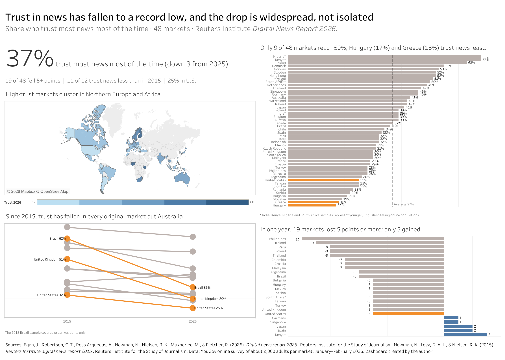

# Trust in News, 2026: A Data Storytelling Dashboard

**Trust in news has fallen to a record low, and the decline is everywhere.** Only 37% of people across 48 markets say they trust most news most of the time. That's the lowest since the Reuters Institute began measuring in 2015.

[**▶ Live Tableau dashboard**](https://public.tableau.com/app/profile/rachael.isle/viz/Lesson5Dashboard_17938961511920/Dashboard1) · [**Interactive case study**](https://rachaelisle.github.io/trust-in-news/)



## The brief
A self-serve dashboard for clients in the news business (newspaper and broadcast executives, public-service media leaders and journalism funders). They know the industry but not survey methods, and they'll read it without a presenter. The dashboard has to deliver the conclusion in seconds and keep caveats beside the numbers they qualify.

## Key findings
| | |
|---|---|
| **37%** | trust most news most of the time across 48 markets (down from 40% in 2025) |
| **9 of 48** | markets reach 50% trust; Hungary (17%) and Greece (18%) are lowest |
| **11 of 12** | original 2015 markets trust news less today. Brazil fell 26 points and the UK 21 |
| **19** | markets fell 5+ points in one year; only 5 rose at all |

## Approach
1. **One consistent source.** Every figure comes from the Reuters Institute Digital News Report, so every number answers the same survey question.
2. **Data prep in Excel.** 48 markets × (2026 trust, one-year change, sample caveat) plus 2015 vs 2026 figures for the 12 original markets.
3. **Validation.** The mean of the 48 transcribed values (36.98%) matches the report's published 37% headline.
4. **Tableau Public build.** Calculated fields handle the highlight color, the ±2-point "meaningful change" filter and selective slopegraph labels. A dual axis adds endpoint dots to the slopegraph.

## Design decisions
Each choice follows Cole Nussbaumer Knaflic's *Storytelling with Data* framework:
- **Choose an effective visual.** A ranked horizontal bar for 48 categories, a slopegraph for two points in time, a diverging bar for gains vs losses and a single-hue choropleth for geography.
- **Eliminate clutter.** Direct labels instead of axes, no extra map layers, and changes of ±2 points or less filtered out as noise.
- **Focus attention.** Everything starts grey. One orange accent marks only the countries named in each chart's action title.
- **Think like a designer.** Action titles state each takeaway, the headline number sits top-left, and caveats sit next to the charts they qualify.

## Repository contents
```
index.html                     Interactive case study (D3.js), deployable with GitHub Pages
data/trust_2026.csv            48 markets: trust %, change vs 2025, sample note
data/trust_2015_vs_2026.csv    12 original markets, 2015 vs 2026
images/dashboard.png           Screenshot of the Tableau dashboard
```

## Data notes
- Measure: % who agree "I think you can trust most news most of the time."
- Kenya, Nigeria, South Africa and India samples represent younger, English-speaking internet users, not whole populations.
- The 2015 Brazil sample was urban only. Change = percentage points vs 2025.

## Sources
- Egan, J., Robertson, C. T., Ross Arguedas, A., Newman, N., Nielsen, R. K., Mukherjee, M., & Fletcher, R. (2026). *Digital news report 2026.* Reuters Institute for the Study of Journalism.
- Newman, N., Levy, D. A. L., & Nielsen, R. K. (2015). *Reuters Institute digital news report 2015.* Reuters Institute for the Study of Journalism.
- Knaflic, C. N. (2015). *Storytelling with data.* Wiley.

## Tools
Tableau Public · Microsoft Excel · D3.js (web version). Claude (Anthropic) was used to check figures and troubleshoot Tableau steps.

---
*Built for DSC330 Data Communication and Visualization for Business, University of Phoenix (2026).*
